# NX 博客设计拆解与个人博客新方案

调研日期：2026-10-17。参考站点：https://legacy.nickxu.me/

后续进度（2026-10-19）：已按本方案实现第一版 Hexo + Butterfly 博客；当前运行方法见项目根目录 `README.md`，验收结果见 `design-qa.md`。下文保留调研当时的判断与边界。

## 结论与当前方向

最贴合这次需求的路径是以 **Hexo + Butterfly** 为基础重新搭建，再替换首页图片／动图、头像、内页背景、标语和个人内容。参考站已经使用这一主题体系，没必要为了得到相似的布局和交互重新实现整套博客引擎。

用户已明确：不再受本仓库旧立项、课程功能或原生 HTML/CSS/JavaScript 技术栈限制。`docs/立项.md` 作为历史文件保留，不作为本次新博客的实施约束。

“保留个性”按用户的具体解释执行：保留喜欢的布局和交互感觉，用自己喜欢的图片、动图等素材表达个人风格。这里不擅自改成极简作品集，也不预设用户的配色、昵称或审美题材。本轮交付是设计与交互拆解、证据和实施方向，尚未搭建新博客。

## 一、工具实际做了什么

使用官方 npm 包 `rea-agents@6.5.0` 的静态 JavaScript 分析工具；通过 `npx` 临时调用，没有执行 `setup`、修改 Codex MCP 配置或安装反编译器。

```bash
rtk proxy npx --yes rea-agents@6.5.0 analyze-javascript-application \
  docs/research/nickxu-2026-10-17/sources \
  --analysis-timeout-ms 60000 --format json
```

本地保存了公开 HTML、CSS、页面脚本和来源清单。REA 实际分析了 4 个相关文件，解析了 3 个 JavaScript 文件、遍历 6,379 个 AST 节点，记录 16 项分析发现，语法解析失败为 0。这里的“发现”是静态结构观察，不是 16 个漏洞或 16 项已验证功能。

- [REA 完整结果](research/nickxu-2026-10-17/rea-static-analysis.json)
- [REA 摘要与局限](research/nickxu-2026-10-17/rea-summary.json)
- [公开资源来源、大小和 SHA-256](research/nickxu-2026-10-17/source-manifest.json)
- Evidence ID：`ev_fb694e18579df35ba35495b8f9968995e8e26899f76547d7776275751f521db1`

REA 在本轮负责静态分析；截图、点击、主题切换、目录跳转和手机宽度检查由浏览器工具完成。没有声称使用 REA 的 CDP 会话采集，也没有把静态分析当成运行时验证。

REA 明确报告覆盖不完整，尤其 HTML 中一段位于第 317 行的内联脚本没有被分析。下面涉及这部分的配置与动画参数，是另行读取公开源码所得。没有恢复作者原始源码仓库、服务端代码或完整 Hexo 配置。

## 二、技术组成与设计骨架

| 项目 | 当前证据 | 判断边界 |
| --- | --- | --- |
| 静态站生成器 | 首页 `meta generator="Hexo 6.3.0"` | 是页面公开声明，不等于检查了构建环境 |
| 主题体系 | Butterfly 资源路径、`btf` 工具对象、主题页面结构与资源 `v=5.5.3` | 确认 Butterfly 体系；版本查询串不证明每个文件都与原版完全一致 |
| 首页背景 | `#page-header` 内联背景 `/static/202202230023824.jpg` | 鹿与森林来自 JPG 静态图，不是 GIF 或视频 |
| 头像 | `/static/favicon.jpg` | 独立图片，可直接替换 |
| 字体 | `my.css` 定义 `tzy`，加载 `ZhuZiAWan.woff2` | 自定义字体是视觉个性的重要来源；此次未验证字体授权和实际下载状态 |
| 标语 | Typed.js 2.1.0；中英文两句循环 | `startDelay: 300`、`typeSpeed: 150`、`backSpeed: 50`，单位 ms |
| 彩带 | `canvas-ribbon.min.js` | 独立 Canvas 装饰，配置 `mobile="false"`、`data-click="true"` |
| 入场动画 | `my.css` 的 `imgblur` | 2 秒内从 `blur(5px)` 过渡到清晰；不是背景图片本身在动 |
| 代码块 | 页面配置 `highlight.js`，工具栏有语言、折叠和复制入口 | 看到了界面与实现；未读取剪贴板验证复制结果 |
| 评论 | 文章页出现 Giscus / Twikoo 切换文字 | 未登录、未发评论，不承诺服务可用 |

整体由三层构成：首屏用大图建立氛围；下方文章列表承担浏览；文章页用目录、代码排版和阅读工具支持长文。个人图片与这些结构分开，因此能够换素材而不破坏使用习惯。

## 三、布局与样式测量

以下为当前公开 CSS 与桌面浏览器 1280 × 720 视口下的测量。截图内容区域约为 1275px 宽，包含滚动条差异；不要把单次像素值当成所有设备的固定尺寸。

| 区域 | 参考站的规则 | 给新博客的启发 |
| --- | --- | --- |
| 首页首屏 | `height: 100vh`；背景 `cover`、居中；标题区域 `top: 43%` | 保留大图氛围，自己的图片需要设置合适的主体焦点 |
| 顶栏 | 左站名，右导航；首屏透明覆盖在背景上 | 不额外塞入一排功能按钮 |
| 内页页头 | 桌面约 400px，768px 以下约 280px | 首页和文章／归档页使用不同素材也能保持统一 |
| 内容容器 | 通常 `max-width: 1200px`，上下 40px、左右 15px padding；超宽屏另有规则 | 保留两侧留白，避免文章撑满屏幕 |
| 主栏／侧栏 | CSS 分配 74%／26%；900px 以下转纵向 | 浏览内容为主，个人卡片辅助识别作者 |
| 实际文章卡 | 桌面列表卡宽约 866px；无封面，文字标题、日期、摘要 | 不必给每篇文章硬配封面才能得到相似感觉 |
| 卡片 | 8px 圆角；阴影 `0 3px 8px 6px rgba(7,17,27,.05)`；卡间距 20px | 柔和的悬浮感，不依赖玻璃拟态或复杂边框 |
| 正文字体 | 全局基准 14px，行高 28px；首页站名约 39.9px，副标题约 24.08px | 新博客可保留比例，正文可适当增至 16px 以提高长文可读性 |
| 文字和强调色 | 浅色正文 `#4c4948`，主题蓝色背景声明 `#49b1f5` | 强调色应从最终个人素材里选，暂不拍板 |
| 手机端 | 768px 以下内容 padding 为 `20px 5px`；顶栏转菜单入口 | 参考站手机边距比较紧，新版可按真实阅读情况略微加宽 |

不要把这套视觉误读成“复杂动效网站”。它主要依靠背景图、字体、卡片比例、留白和少量持续动作建立气质。

## 四、截图与交互证据

### 1. 桌面首页：正常

整屏鹿与森林背景、居中站名、循环打字副标题、底部向下指引。背景主题决定第一印象；站名保持醒目。

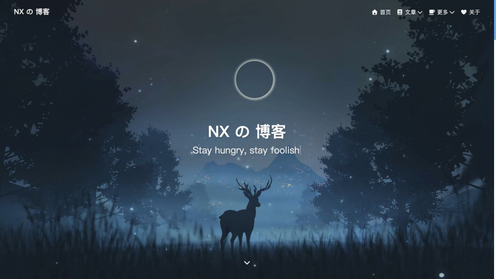

### 2. 向下浏览文章列表：正常

左侧文字文章卡，右侧头像、作者资料、统计、公告与内容入口。下方彩带独立于背景图存在。右下角工具栏在滚动后出现。

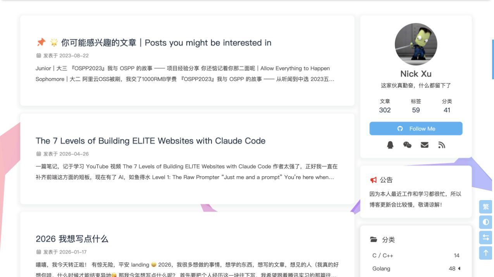

### 3. 深浅色切换：已实测生效

点击右下角主题按钮，页面和卡片切换为暗色。`main.js` 的 `rightSideFn.darkmode` 更新主题，并通过 `btf.saveToLocal` 保存偏好。偏好的过期／刷新行为没有另外实测。

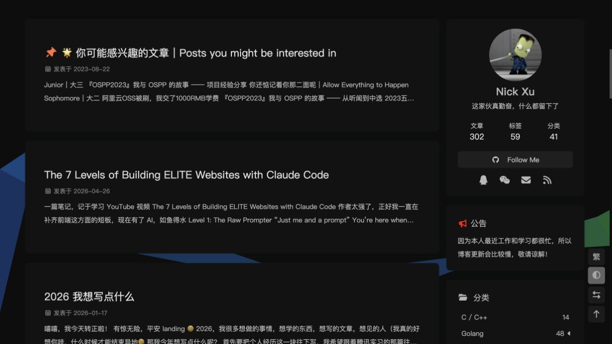

### 4. 单／双栏切换：已实测生效

点击后侧栏隐藏，主栏居中扩展。对应 `hide-aside` 状态。它与文章专用“阅读模式”是不同功能；本次未单独测试阅读模式按钮。

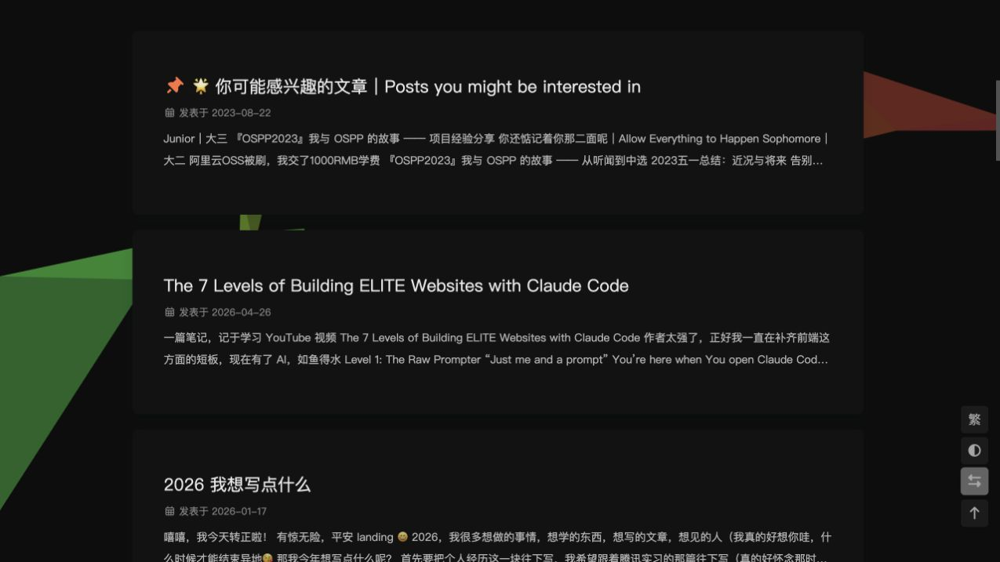

### 5. 打开文章：正常

文章页换成较短的配图页头，标题左对齐，附发表／更新时间、字数和阅读时长。下方正文卡仍与侧栏对齐。

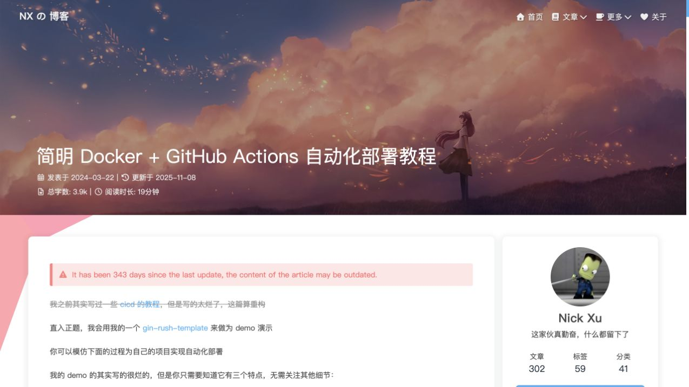

### 6. 代码与目录：排版已检查，复制未实测

代码使用等宽字体、行号和工具栏；目录作为侧栏卡片，滚动时显示阅读进度。截图中的浅灰代码颜色较淡，新博客应检查对比度。

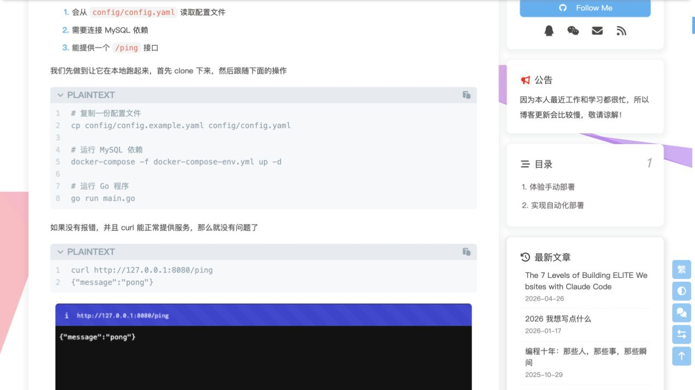

### 7. 点击目录定位章节：已实测准确

点击“2. 实现自动化部署”，平滑滚动完成后目标标题位于视口顶部，目录对应项高亮。最终标题 top 约为 -0.12px，见 [实测记录](research/nickxu-2026-10-17/toc-check.json)。不是只检查链接是否存在。

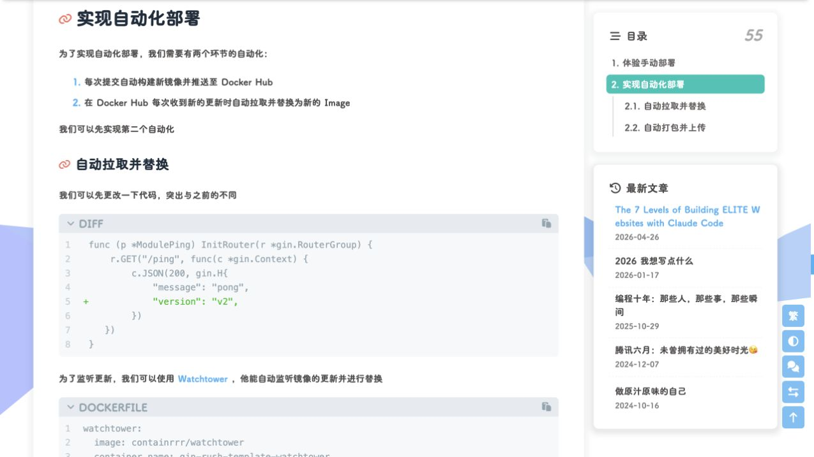

### 8. 手机首页：390 × 844 视口检查正常

同一张横图居中裁成竖屏，鹿、月亮仍能保留；顶栏收为菜单图标，社交链接出现在标题下方。说明选背景时需要同时考虑两个画幅。这是浏览器视口测试，非真实手机性能测试。

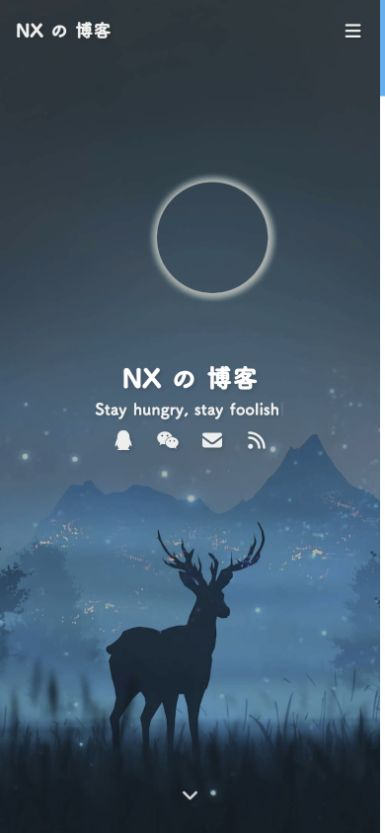

### 9. 手机菜单：已实测打开和导航

点击右上角菜单后，右侧抽屉展示头像、统计和分组导航，左边遮罩压暗背景。从抽屉点击“归档”成功进入归档页。菜单入口使用非原生按钮元素，键盘与辅助技术支持应在新版单独验收。

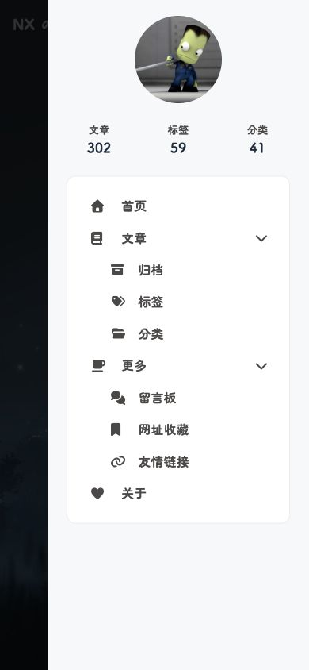

### 10. 手机归档：布局正常

年份、日期、文章标题组成纵向时间线，适合按时间回找内容。内页页头明显比首页短，让内容较快进入视野。

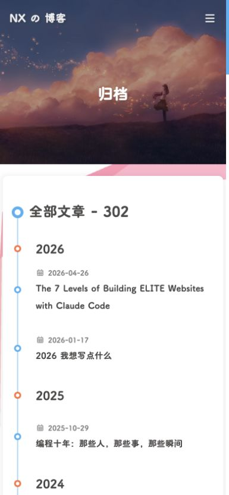

### 11. 标签页：布局正常，所有标签筛选结果未逐项检查

标签使用不同大小、颜色的块状链接，沿用统一页头和侧栏。新品可以保留分类／标签入口，但颜色应尽量与个人素材协调。

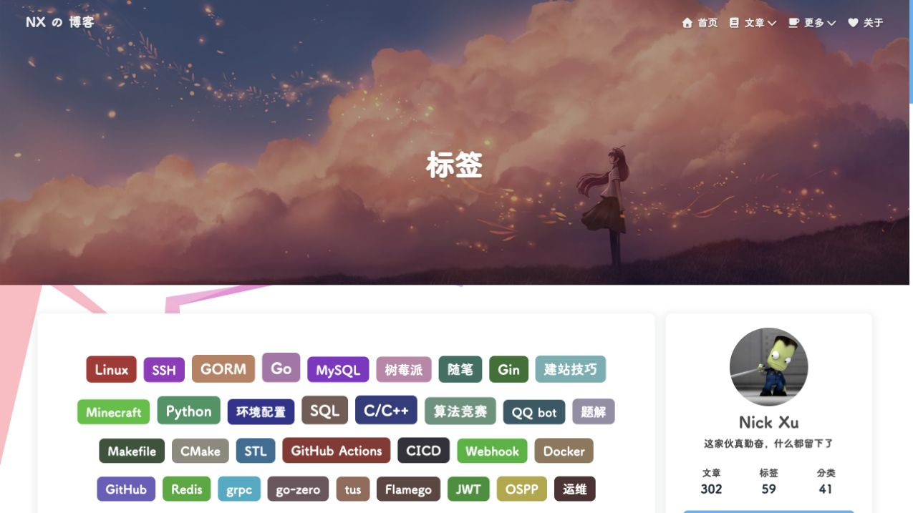

## 五、如何放进你喜欢的图片和动图

| 素材位 | 建议替换内容 | 保留的结构 | 实施注意 |
| --- | --- | --- | --- |
| 首页大背景 | 你喜欢的场景、动漫画面、游戏画面、照片或短循环动图 | 整屏背景、站名、副标题、向下入口 | 桌面与手机分别设焦点；图片亮区不能淹没标题 |
| 内页页头 | 与首页同系列的另一张图，或较安静的裁切 | 文章标题和分类／归档页头 | 不必所有页面都播放同一段动态背景 |
| 头像 | 个人头像、角色头像或轻量 GIF | 圆形头像与作者卡 | 裁切不要切掉脸；动图和悬停旋转不宜叠得过重 |
| 标语 | 你自己的短句或数句循环 | 打字切换的位置和节奏 | 语句长短要适合手机，不照搬作者文案 |
| 文章插图／封面 | 自己的照片、截图或喜欢的主题插画 | 文章卡与正文结构 | 首页目前是文字卡，可以只在特定文章配图 |
| 细小装饰 | 喜欢的角色动图或少量彩带 | 与正文不重叠的装饰层 | 优先放边角；不遮挡点击区域和移动端正文 |
| 站点图标与社交入口 | 自己的图标、昵称和链接 | 顶栏与作者卡入口 | 不继承参考站作者的联系方式或统计数据 |

先确定一张主背景和一个头像，就足够做第一版视觉校准。其余素材可以沿用同一主题慢慢补，不需要先准备完整品牌系统。

GIF 可以直接作为图片或背景，但持续动画不容易暂停。大幅循环场景更适合评估 WebM/MP4 视频背景：保留静态 poster、静音、循环、行内播放，并处理自动播放被阻止的情况。具体格式应看用户提供的原素材，不预先强制转换。

新版应具备静态后备图和减少动态效果的处理：开启 `prefers-reduced-motion` 时展示静态画面；读长文时减少持续运动；给持续播放的动态背景提供可用的暂停入口。GIF 也应准备一张独立静态替代图，不能仅靠取消 CSS 动画来“暂停 GIF”。

建议把大图、头像和装饰作为各自独立的本地资源管理，不直接引用参考站的资源地址。参考站素材在本报告中用于说明位置，不作为新站默认素材。

## 六、重新搭建的最小完整方案

默认选择 **Hexo + Butterfly + 独立主题配置 + 少量自定义 CSS/JS**。理由是参考站的主要外观与交互本来就存在于这套体系；用户当前要的是类似博客和个人素材，而非重新开发一个博客管理平台。官方提供主题安装、独立配置与自定义入口，不需要先改主题内部文件。

建议的第一版范围：

1. 首页：个人背景、站名、打字标语、文字文章卡、作者卡。
2. 文章：正文、代码高亮与复制、目录定位、上一篇／下一篇。
3. 发现内容：归档、标签、分类、关于页。
4. 通用交互：深浅色、回到顶部、侧栏切换、手机抽屉与目录。
5. 个性化：背景／头像／标语单独配置，静态图与动图都预留展示方式。

内容用 Markdown 管理。评论可以后接 Giscus 或 Twikoo；在确认需要之前，不引入本地账号、作者后台、点赞收藏数据库和网络多用户功能。若后续明确要求浏览器内写作后台，再重新评估 CMS，不能把主题博客和完整应用平台混为一谈。

未来实施主要涉及：站点配置、主题独立配置、素材目录、自定义样式、必要的动态背景脚本、Markdown 页面，以及桌面／手机交互验证。旧课程文档和旧功能清单不再决定这些文件的设计。

## 七、验证范围与尚未验证项

已验证：桌面首页与列表；主题和侧栏切换；文章页与代码排版；目录点击后的最终位置与高亮；390px 宽手机首页、菜单与归档；桌面标签页。截图中误抓到的加载模糊帧和目录滚动中间帧已用最终稳定状态覆盖。手机视口覆盖已重置。

未验证：所有文章／标签链接、登录和评论提交、代码复制结果、真实手机浏览器、网络慢速和性能、完整键盘操作／读屏、图片放大、阅读模式按钮及用户尚未提供的 GIF／视频播放。页面脚本存在通用图片灯箱实现，但首页配置 `lightbox: 'null'`，因此不能把“主题有此代码”写成“本站已启用图片放大”。首页搜索配置也为 `undefined`，不能把搜索列为目标站已启用功能。

可见的改进机会：正文基准字号偏小；浅色代码块文字较淡；手机内容离边缘较近；部分交互入口并非原生按钮。新版在保持布局感觉时应改善这些细节。当前没有进行完整无障碍合规审计。

## 参考资料

- [目标博客](https://legacy.nickxu.me/)
- [REA 官方仓库](https://github.com/morluto/rea)
- [REA 网站观察工具说明](https://github.com/morluto/rea/blob/main/docs/browser-observation.md)
- [Butterfly 快速开始](https://butterfly.js.org/posts/21cfbf15/)
- [Butterfly 主题配置](https://butterfly.js.org/posts/4aa8abbe/)

公开资源快照和 REA 输出保留在 `docs/research/nickxu-2026-10-17/`，用于复核本报告，不是新博客的运行代码。
